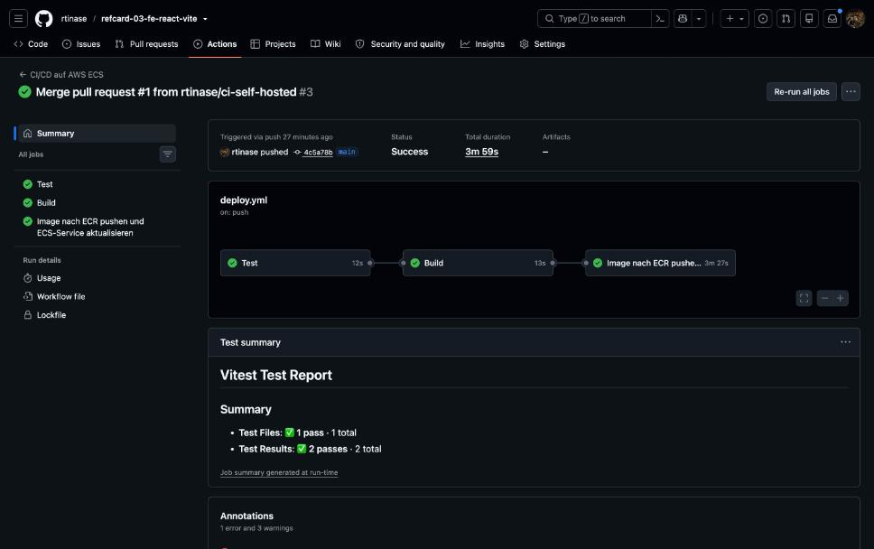
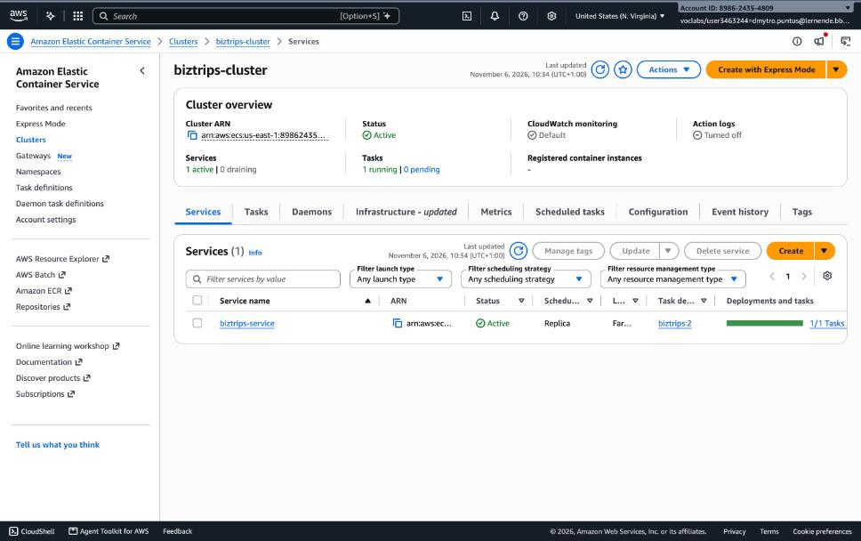
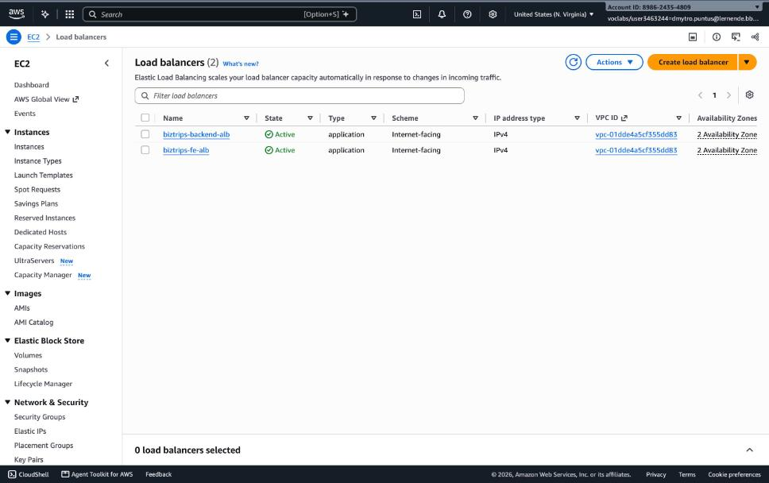
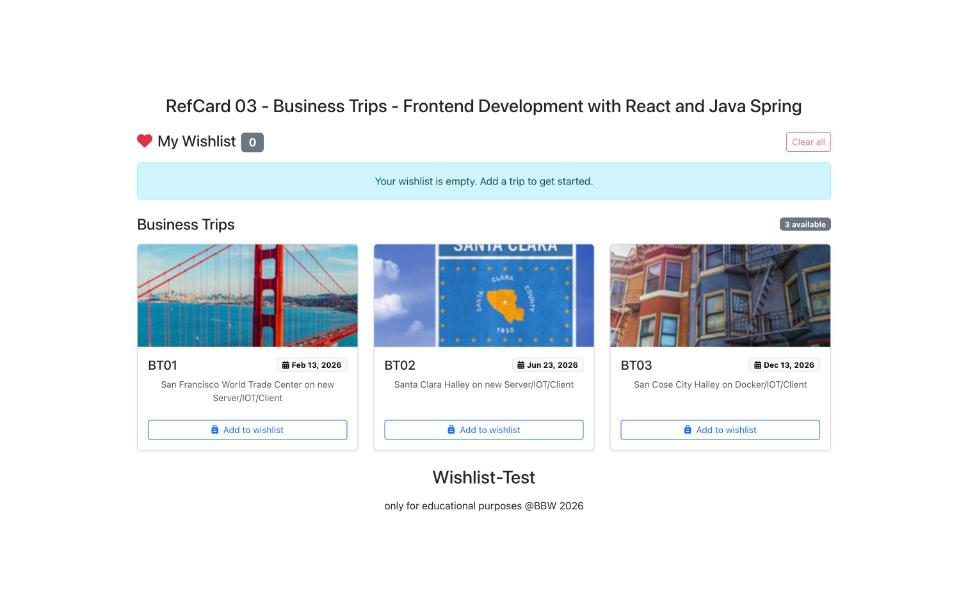

# RefCard 03 – Frontend: EX-03 (ECS Fargate)

Repository: <https://github.com/rtinase/refcard-03-fe-react-vite>
Backend-Repository: <https://github.com/rtinase/RefCard-03-be-SpringBootBusinessTrips> (Doku dort: `docs/EX-03-EX-04-Ergebnis.md`)
Umgebung: AWS Academy Learner Lab, Region `us-east-1`, Account `898624354809`

| Komponente | URL |
| --- | --- |
| Frontend (ECS Fargate hinter ALB) | `http://biztrips-fe-alb-613393037.us-east-1.elb.amazonaws.com/` |
| Backend (wird vom Frontend aufgerufen) | `http://biztrips-backend-alb-1126669786.us-east-1.elb.amazonaws.com/` |

## Architektur

```
Browser → ALB (Port 80) → ECS-Service (Fargate, nginx, Port 80) → Image aus ECR
Browser (JavaScript) → Backend-ALB → Backend-Tasks → RDS
```

Das Image ist ein Multi-Stage-Build: Node baut die Vite-App, im finalen Image liegen nur die statischen Dateien
und nginx (kein Node, kein Quellcode).

## Vorgehen (Kurzfassung)

1. **ECR-Repository** `biztrips`, **ECS-Cluster** `biztrips-cluster`, Log-Group `/ecs/biztrips`.
2. **Security Groups:** ALB (Port 80 aus dem Internet) → Tasks (Port 80 nur von der ALB-SG).
3. **Target Group** `biztrips-fe-tg` (Typ `ip`, Port 80, Health-Check `/`) und **ALB** `biztrips-fe-alb`.
4. **Task Definition** (`task-definition.json`, `LabRole`) und **ECS-Service** `biztrips-service`.
5. **Pipeline** (`.github/workflows/deploy.yml`): `test` (Vitest) → `build` (Vite) → `deploy-ecs`
   (Image bauen, nach ECR pushen, Task Definition aktualisieren, Service deployen).
6. Die Backend-URL wird **zur Build-Zeit** in das JS-Bundle eingebaut. Sie kommt aus der
   Repository-Variable `VITE_API_BASE_URL` und wird im Workflow als Docker-Build-Argument übergeben.
   Sie ist kein Geheimnis und deshalb eine Variable und kein Secret.

## Pipeline auf eigenem Runner

Der GitHub-Account ist wegen eines Billing-Problems gesperrt, die von GitHub gehosteten Runner starten nicht
(`startup_failure`). Die Pipeline läuft deshalb auf einem **self-hosted Runner in einem lokalen
Docker-Container** (`runs-on: [self-hosted, local-docker]`). Auf Apple Silicon wird das Image mit
`--platform linux/amd64` gebaut, weil Fargate hier `x86_64` verwendet. Die AWS-Zugangsdaten des Learner Labs
liegen als GitHub Secrets und laufen mit der Lab-Sitzung ab.

## Ergebnis (Screenshots)

**Pipeline: Test, Build und Deploy nach ECS laufen grün (Run auf dem lokalen Runner)**


**ECS-Service `biztrips-service` im Cluster `biztrips-cluster` (1 Task läuft)**


**Application Load Balancer für Frontend und Backend**


**Die App läuft auf ECS und lädt die Trips vom Backend (Änderung → Wirkung)**


### Änderung → Wirkung

Zuerst zeigte das Frontend «No business trips available». Die Browser-Konsole meldete einen CORS-Fehler, weil
das Backend nur `localhost`-Origins erlaubte. Nach der Änderung im Backend (Origins konfigurierbar, Frontend-ALB
erlaubt) und dem automatischen Redeploy der Pipeline zeigt die Seite die drei Business Trips (BT01–BT03).

## Aufräumen

ECS-Service auf `desired-count 0` setzen und löschen, ALB und Target Group löschen, Cluster und
ECR-Repository `biztrips` entfernen (Learner Lab hat ein Kostenlimit).
